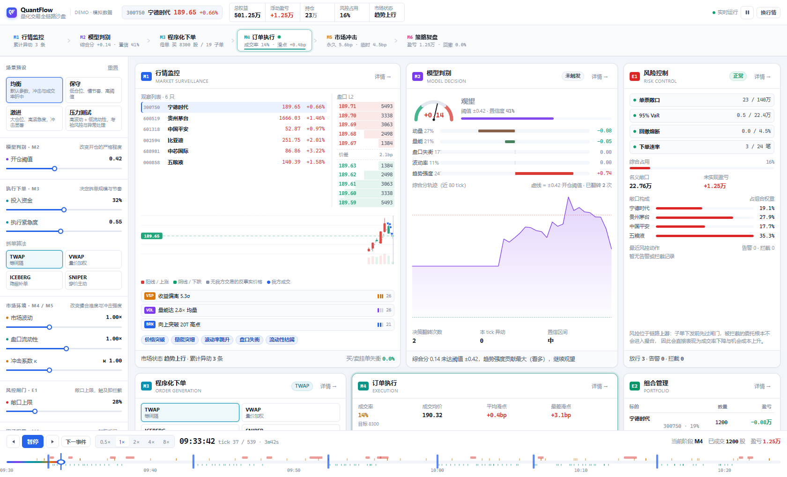
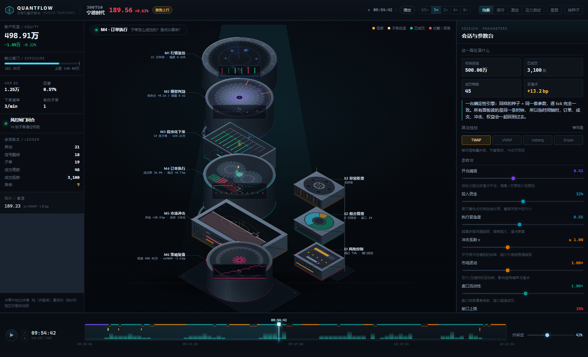
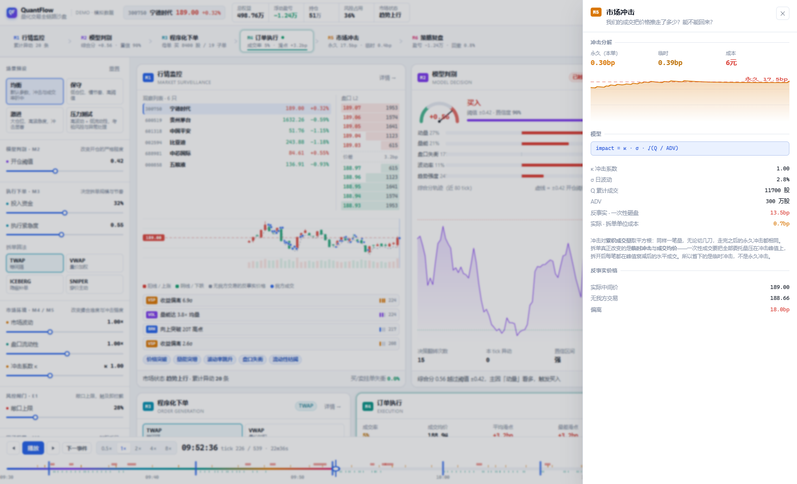
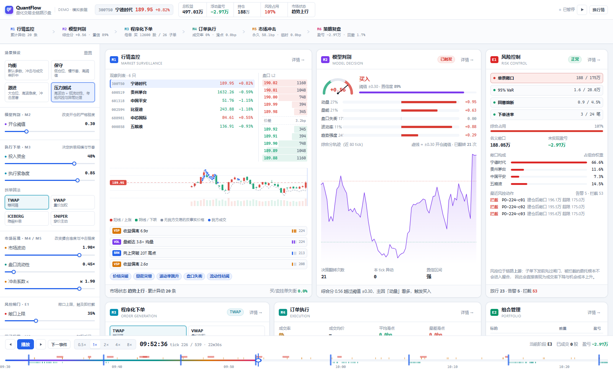
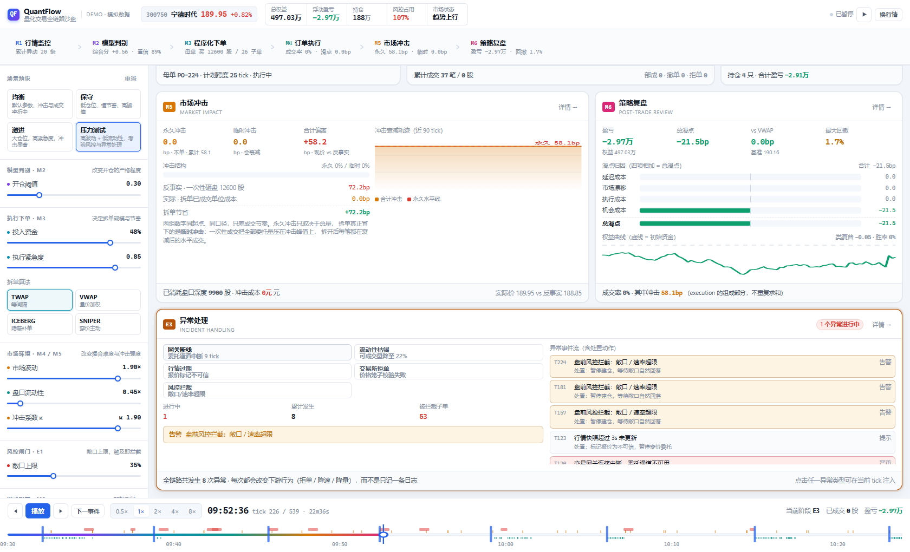
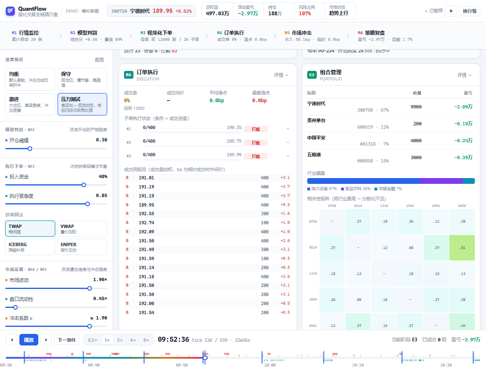

# QuantFlow · 股票量化交易全链路可视化

一个把「行情识别 → 模型判别 → 程序化拆单 → 订单执行 → 市场冲击 → 策略复盘」整条链路摊开在屏幕上的交互式沙盘。
所有模块由**同一个仿真时钟**驱动，拖动时间轴或改一个参数，九个面板会同步演化——不是一个页面里塞了几张静态图。



---

## 快速开始

```bash
# 环境：Node 20+（开发使用 22.22.2）
npm install

npm run dev       # http://127.0.0.1:5178
npm test          # 40 条用例（引擎 23 + 界面 17）
npm run build     # tsc --noEmit && vite build
npm run preview   # 预览生产构建
```

内置确定性模拟数据，**零后端、零网络请求、零密钥**，`npm install` 之后即可离线跑通。

**Windows 不想敲命令**：双击根目录的 `start-dev.cmd`，它会检查 node、缺依赖时自动 `npm ci`，然后起服务并打印地址。

> 开发服务器需要**在你自己的终端里**启动。由 AI 助手在后台代起的进程通常会在该轮对话结束时被一并回收（表现为链接过一会儿就打不开，而控制台并无报错）。项目本身没有常驻进程，随时 `npm run dev` 即可。

---

## 九个面板各回答什么问题

| 阶段 | 面板 | 回答的问题 | 实时指标 |
| --- | --- | --- | --- |
| M1 | 行情监控 | 现在该看哪只票？盘口在说什么？ | K 线 / 盘口 L2 / 逐笔 / 6 只观察列表 / 异动计数 |
| M2 | 模型判别 | 为什么此刻买、卖、还是不动？ | 五因子打分、综合分轨迹、置信度、决策翻转次数 |
| M3 | 程序化下单 | 一笔大单怎么切成小单？ | 母单额度、算法选择、子单节奏、子单队列（限价偏移/状态） |
| M4 | 订单执行 | 每张子单成交了多少、付了什么价？ | 成交率、成交均价、平均/最差滑点、逐笔回报 |
| M5 | 市场冲击 | 是我们把价格推走的吗？ | 永久/临时冲击、反事实价格、拆单 vs 一次性砸盘 |
| M6 | 事后复盘 | 这单到底亏在哪一步？ | 滑点四分解瀑布、vs VWAP、权益曲线、最大回撤 |
| E1 | 风险控制 | 闸门什么时候会掐断交易？ | 敞口/VaR/回撤/速率四道闸、敞口构成、最近风控动作 |
| E2 | 组合管理 | 仓位集中在哪、分散够不够？ | 持仓表、行业暴露、相关性热力图 |
| E3 | 异常处理 | 断线、闪崩、拒单发生时系统怎么反应？ | 异常事件流（含处置动作）、可在当前 tick 手动注入 |

延伸方向不是装饰：E1 被拦截的子单**不会进入撮合**，直接表现为 M4 成交率下降与 M6 机会成本上升；
E3 注入断线后，M4 会出现 `rejected` 子单、M3 的下发节奏被打断——因果是连着的。

---

## 交互

- **时间轴**：拖动即 seek（只换数组下标，不做重放），播放与拖动走同一条渲染路径
- **播放控制**：播放/暂停、0.5×–8× 倍速、上一事件 / 下一事件（跳到下一个异动或异常）
- **参数滑块**：开仓阈值、投入资金、紧急度、冲击系数、市场波动、流动性、敞口上限——松手 90ms 后重算整场会话
- **预设**：均衡 / 保守 / 激进 / 压力测试，一键换一套参数
- **因子权重**：五个因子各一条，直接改变 M2 的综合分
- **详情抽屉**：点卡片右上角「详情」或链路节点，下钻该阶段的完整明细
- **异常注入**：E3 里点任一异常类型，在当前 tick 插入
- **手动下单**：无母单时可直接强制买入/卖出
- **键盘**：`空格` 播放暂停、`←/→` 单步（`Shift` 加速）、`Home/End` 首尾




---

## 模型约定（可复现性的来源）

1. **确定性伪随机**：全项目禁用 `Math.random`，统一用 mulberry32。同一个 `seed`（默认 `20261110`）+ 同一套参数，逐 tick 的价格、成交、异动完全一致。
2. **反事实世界**：先算出「完全无我方交易」的基准价格序列 `baseline[]`，实际价 = 基准价 × 冲击因子。M5 的对比、M6 的归因都有唯一真值来源。
3. **平方根冲击律**：`impact = κ · σ · √(Q / ADV)`，对**累积成交量**求值再取增量，因此冲击对总量次线性；临时冲击按 `exp(-1/9.5)` 逐 tick 衰减，永久冲击不可回撤。
4. **滑点四分解**：`总滑点 = 延迟 + 市场漂移 + 执行 + 机会成本`，按**目标委托量归一**（已成交按成交价、未成交按当前价加权），恒等式严格闭合，由测试守着。
5. **拆单唯一省的是临时冲击**：永久冲击只取决于总量，切几刀都一样。M5 的「一次性砸盘」反事实与实付成本严格同起点、同口径，否则比较没有意义。
6. **快照存副本**：母单对象在仿真中会被原地修改，快照必须拷贝，否则拖回过去会看到这单最终的样子（这条也有测试守着）。




---

## 目录结构

```
src/
├── core/        # 领域类型、确定性 PRNG、格式化、阶段元数据
├── model/       # 纯函数层：行情路径、异动检测、五因子信号、
│                # 拆单规划、撮合、冲击、风控、组合、复盘归因
├── engine/      # simulate.ts：单 tick 编排，把 model 串成一条链路
├── store/       # Zustand：参数 / 播放状态 / 仿真结果，90ms 防抖重算
└── components/
    ├── ui/          # Card、Slider、Segmented、Stat、Meter、Chip…
    ├── charts/      # 全手写 SVG：K 线、冲击曲线、权益曲线、仪表盘、热力图
    ├── layout/      # 顶栏、链路导航、控制台、时间轴、详情抽屉
    └── modules/     # 九张业务面板
```

模型层全部是**不依赖 React 的纯函数 / 纯类**，可以单独 `import` 到脚本或测试里跑；
界面只负责把 `Snapshot` 画出来，不参与任何业务计算。

---

## 测试与验证

```bash
npm test
```

- **引擎 23 条**：tick 序列完整、价格量级合理、t=0 盈亏归零、权益与盈亏自洽、确定性（同 seed 逐 tick 相等）、
  全链路串联（异动→决策→母单→成交→冲击→复盘）、滑点分解闭合、**快照不泄漏未来**、冲击成本口径、边界（极小仓位/极高阈值/低流动性高压）。
- **界面 17 条**：九个面板全部挂载、时间轴联动、播放态切换、抽屉开关、参数与算法切换触发重算、预设联动、异常注入、手动下单、推进边界（dt 为负 / tick 越界不出负宽度）。

视觉回归用 Playwright 脚本：

```bash
python scripts/shot.py shots http://127.0.0.1:4178/     # 六个典型状态整屏
python scripts/shot_cards.py shots/cards http://127.0.0.1:4178/   # 逐卡 1:1，并检测溢出
python scripts/shot_full.py shots/full.png http://127.0.0.1:4178/ 1680 1080
```

`shot_cards.py` 会顺带输出每张卡的宽高与 `scrollHeight > clientHeight`，用来抓「内容被卡片裁掉」的问题。

---

## 已知取舍

- **数据是仿真的**，标的价格、成交量、盘口、异动都是生成出来的；它不是行情回放工具，而是把交易链路讲清楚的沙盘。
- 撮合是**两路简化模型**：穿价则逐档吃对手盘（价格加权、可部分成交），未穿价则按「可成交量 / 队前挂单量」算成交概率，且被动单必须真实触及价位才算成交。不模拟队列位置漂移与撤单竞争。
- 单会话 540 tick（≈54 分钟）足以看清一轮完整的开平仓，但不覆盖跨日持仓与隔夜风险。
- 九个面板加起来比一屏高，画布**需要滚动**——这是内容密度换来的，不是布局缺陷。



---

## License

MIT
