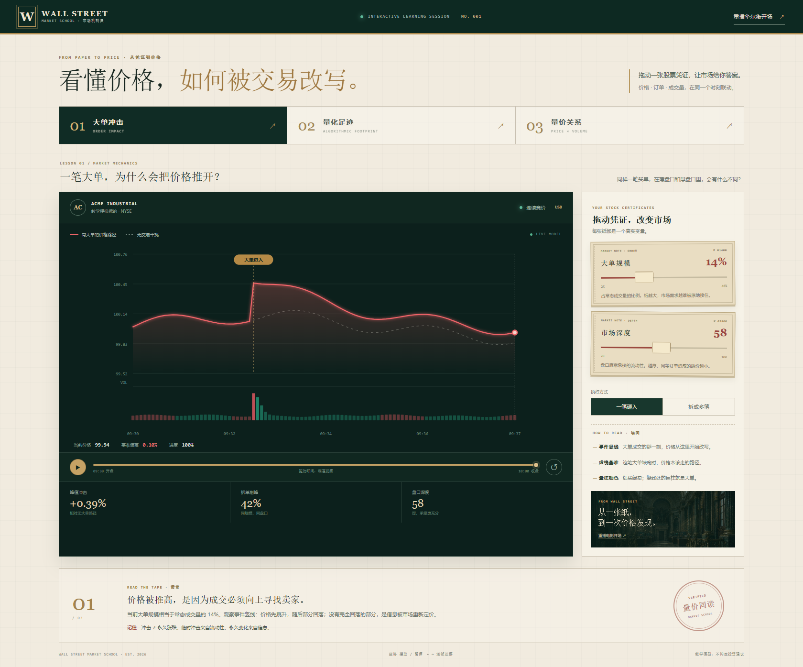
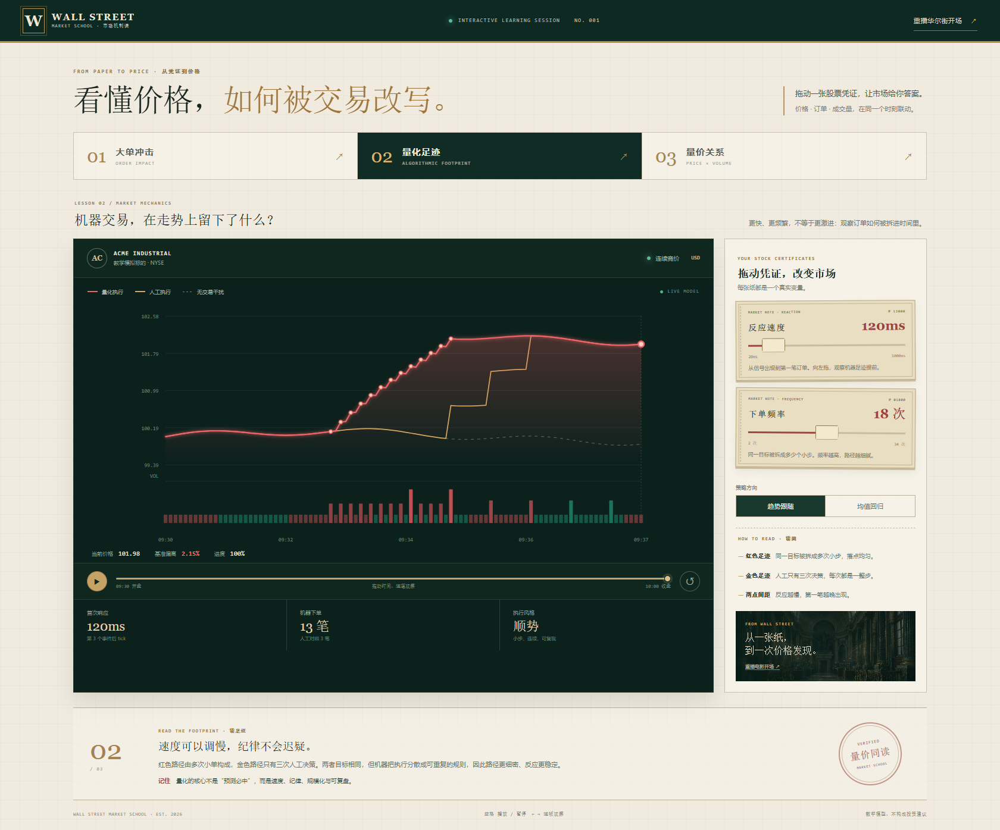
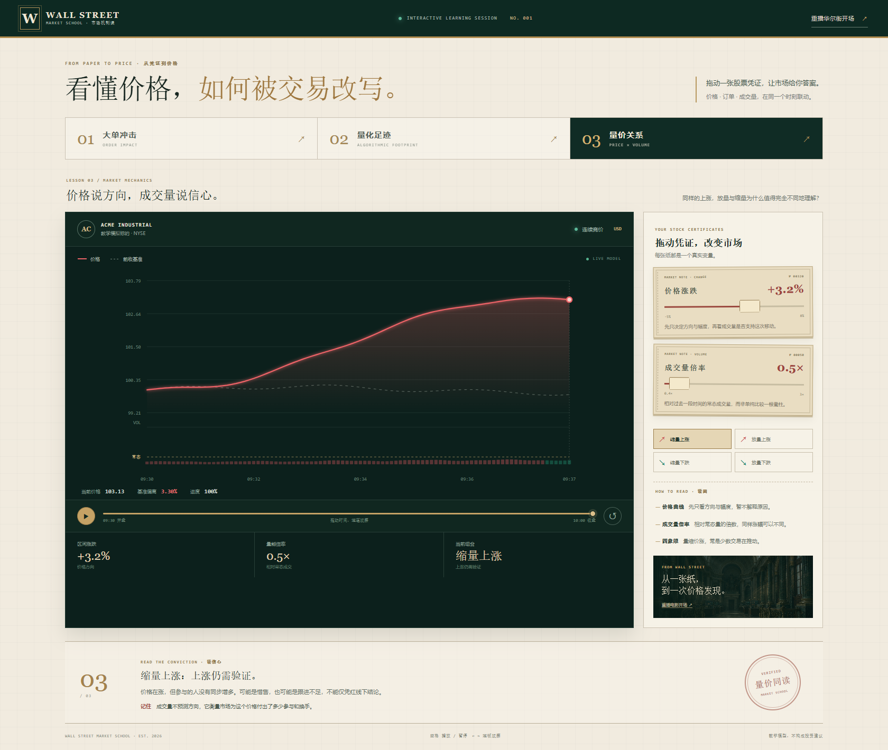
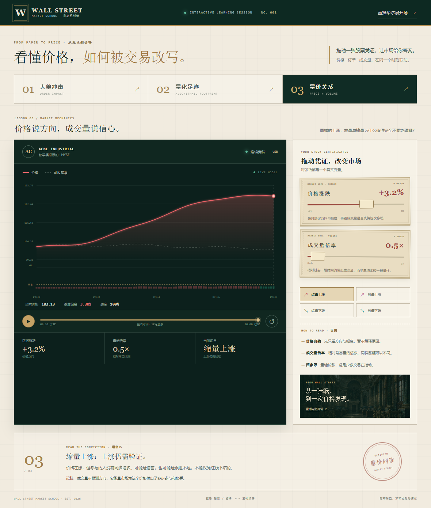

# QuantFlow · 华尔街市场学校

一段电影式开场，把观众从华尔街街口送进交易所大厅；落座之后，**每一张纸质股票凭证都是一个可拖动的市场变量**。

> 从一张纸，到一次价格发现。


三节课，回答三个真问题：

| 课 | 问题 | 拖动什么 |
| --- | --- | --- |
| **01 大单冲击** | 一笔大单，为什么会把价格推开？ | 大单规模、市场深度、一笔砸入 / 拆成多笔 |
| **02 量化足迹** | 机器交易，在走势上留下了什么？ | 反应速度、下单频率、趋势跟随 / 均值回归 |
| **03 量价关系** | 价格说方向，成交量说信心。 | 价格涨跌、成交量倍率 |

---

## 1. 为什么不是又一个仪表盘

量化交易最难讲清的从来不是指标，而是**因果**：为什么这一笔抬高了两分钱、为什么拆单反而更贵、为什么同样的上涨这次不该追。

仪表盘把因果拆成一堆互不相干的数字，读者只能被动接受结论。所以这里换了两件事：

1. **先给空间感**。开场是一段真镜头：镜头沿华尔街推进 → 视角一转让一摞纸质股票被风卷起 → 纸被吸进纽交所的门洞，门里先亮起来 → 白光一闪，落到教学页。**你不是在看一个页面，你是走进了一个地方。**
2. **再给手感**。教学页上所有滑块都是**纸质股票凭证**（带齿孔、编号、旋转的纸感），拖它就是在"改写市场"；图上的每一根量柱、每一次跳价都立刻跟着变。


---

## 2. 开场的四拍

开场总长 **11.8s**，可以随时「跳过开场」，教学页顶部也能「重播华尔街开场」。

| 进度 | 画面 | 实现 |
| --- | --- | --- |
| 0.00–0.25 | 街口 + `WALL STREET` 标题浮起 | 街景层持续 scale（1.03 → 1.9）、轻微 rotate 与位移，做出推进的错觉 |
| 0.33–0.70 | 13 张股票凭证被风卷起 | 每张独立轨迹：起点铺在街面左下那一摞，沿贝塞尔弧线上抛再俯冲 |
| 0.50–0.74 | 门洞内部亮起 | `.cinema-door-glow` 用 `mix-blend-mode: screen` 叠一层暖白，为闪白**准备来源** |
| 0.66–0.86 | 交易所内景淡入 + 大厅字幕 | 内景独立图层，opacity 交叉淡入，构图保持一点透视对齐街景纵深 |
| 0.865 | 白光闪切 | 高斯脉冲 `exp(-((p-0.865)/0.026)²)`，闪完进教学页 |


> 两个坑记在这里：① 纸张的终点不能取画面正中，得取**镜头推到最近时门洞在视口里的位置**（约 51% / 77%），否则纸看着像悬在半空的贴纸；② 街景层自己带 scale，所以这个终点不是图中门洞的静态坐标。

---

## 3. 三节课的模型

全部是纯函数（`src/teaching/lessons.ts`），**96 个采样点、事件固定在第 30 点、不使用随机数**——同样的输入永远得到同样的图，截图和测试才有意义。

### 01 大单冲击

```
冲击幅度% = orderSize / depth × 1.6
一笔砸入：lift = 冲击 × (0.26 + 0.74·e^(−age/15))     ← 立刻跳升，再衰减到永久部分
拆成多笔：lift = 冲击 × (0.20·ease + 0.44·settled)     ← 20 个 tick 摊开，峰值被削平
```

- 峰值冲击衡量"这一笔把价格推了多远"；**拆单削峰**衡量同规模、同盘口下把时间摊开后省下的百分点。
- 虚线是**这笔大单缺席时**的价格路径，实线与它的差就是冲击——所以"临时冲击"和"永久重定价"能在同一张图上分开看。



### 02 量化足迹

```
机器：首次下单延迟 = reaction / 38 tick，之后每 34/frequency tick 走一小步（最多 12 步）
人工：延迟 19 tick，只走 3 大步
两者目标相同（±2.15%），路径完全不同
```

红色（机器）是密而均匀的小步，金色（人工）是稀疏的大跳。**重点不是"机器更强"，而是同一件事被拆成可重复规则的形状，在图上是可以直接看出来的。**



### 03 量价关系

```
价格 = 100 + 涨跌幅 × ease + 波动
成交量 = 28 × 倍率 × 脉冲 × 趋势加成
判定：涨跌阈值 ±0.35%，放量 ≥1.35×，缩量 ≤0.8×
```

四象限是**判定结果**而不是选择器：拖价格与量能，落在哪一格由阈值决定，结论文字同步改写。

成交量纵轴是**固定量纲**（不是按当期最大值自适应），并在"常态量"处画一条虚线基准——
否则拖倍率柱高不变，这一课就没有可看的东西了。

| 组合 | 读法 |
| --- | --- |
| 放量上涨 | 趋势获得确认：买盘推高报价，也带来真实换手 |
| 缩量上涨 | 上涨仍需验证：参与没有同步增多，可能惜售也可能跟进不足 |
| 放量下跌 | 抛压集中释放：高换手下跌，需结合位置判断是延续还是出清 |
| 缩量下跌 | 承接意愿不足：不是"卖盘小所以安全"，而是市场还在等新平衡 |



---

## 4. 交互清单

| 操作 | 效果 |
| --- | --- |
| 拖纸质凭证 | 该变量驱动图、量柱、指标条与底部讲解同帧更新 |
| 一笔砸入 / 拆成多笔 | 切换执行方式，价格路径从"一步跳升"变成"一串涟漪" |
| 趋势跟随 / 均值回归 | 机器足迹换方向，人工作对照仍在原位 |
| 播放 ▶ / 暂停 Ⅱ | 用 8.2s 把这一课重放一遍（光标跟着走） |
| 拖进度条 / ← → | 手动走到任意时刻；← → 每次 4% |
| 空格 | 播放 / 暂停 |
| 01 02 03 章节 | 换课，参数保留 |
| 跳过开场 / 重播开场 | 进教学页 / 从头再放一遍电影 |

底部讲解区（`READ THE TAPE` / `READ THE FOOTPRINT` / `READ THE CONVICTION`）随参数改写标题与正文，
右侧 `HOW TO READ` 固定告诉你"该看画面的哪个部分"。



---

## 5. 代码结构（原子化）

```
src/
├── cinema/                 开场：一层一件事
│   ├── CinematicIntro.tsx  时间轴编排（进度 p → 每个图层的 opacity/transform）
│   └── cinema.css          街景/内景/纸/风线/颗粒/闪白
├── teaching/
│   ├── lessons.ts          三课的纯函数模型 + 判定阈值 + 指标（零 React，可直接测）
│   ├── LessonChart.tsx     SVG 走势图：价格线、对照线、量柱、事件标记、逐笔成交点、悬停读数
│   ├── PaperSlider.tsx     纸质凭证滑块（原生 range，键盘可用，拇指做成小纸片）
│   └── TeachingApp.tsx     章节、证书栏、指标条、讲解区的编排
├── styles/academy.css      市场学校的排版系统（深绿 + 米纸 + 金）
├── components/ core/ model/ engine/ store/   ← 见 §8：v1 机械装配体的遗留实现
└── __tests__/              lessons / app / engine
```

分层规则：`lessons.ts` 不认识 React，`LessonChart` 不认识业务参数（只吃 `MarketPoint[]`），
`TeachingApp` 只负责编排与状态。想加第四课，只需要在 `lessons.ts` 加一个构造函数、在 `LESSONS` 加一条元数据。

---

## 6. 开发

```bash
npm ci            # 或 npm install
npm run dev       # http://127.0.0.1:5178
npm test          # 38 条用例
npm run build     # tsc --noEmit && vite build
npm run preview   # http://127.0.0.1:4178
```

产物：`dist/index-*.js ≈ 248KB (gzip 79.5KB)`、`css ≈ 22.3KB (gzip 6.2KB)`。

> 端口写死并加了 `--strictPort`：本机曾经有旧实例占着 5178，端口被顶掉会静默拍到上一个版本。

### 测试

- `src/__tests__/lessons.test.ts`（14 条）：同输入同输出、冲击随规模单调、薄盘口跳得更高、
  拆单削峰为正、反应越快首笔越早、量价四象限边界、成交量轴是固定量纲（否则拖倍率柱高不变）。
- `src/__tests__/app.test.tsx`（10 条）：首屏是开场且可跳过、三课切换、滑块写参后图随之变、
  空格与方向键、章节高亮、重播开场。
- `src/__tests__/engine.test.ts`（14 条）：v1 确定性仿真内核的回归（见 §8）。

### 视觉回归

```bash
python scripts/shot.py docs/screenshots http://127.0.0.1:4178/   # 10 个状态 + 控制台错误数
python scripts/snap.py shots/now.png http://127.0.0.1:5178/      # 单张快照
```

`shot.py` 会打印 `CONSOLE_ERRORS`，**交付标准是 0**。

开场三帧是按**进度条比例**取帧的，不是固定 `sleep`：截图本身要几百毫秒，而闪白只占 0.03 的进度，
晚一拍就会拍到一层 `rgba(255,253,244,.78)` 的白雾，看起来像"整幅发白"的 bug。

---

## 7. 已知边界

- 这是**教学演示**，行情与成交是脚本化的，不接真实柜台，不能用来验证策略收益或做交易建议。
- 开场的两张场景图是 AI 生成的电影感实拍风格（`public/assets/*.webp`），不是真实街景照片。
- 纸张飞行、闪白、镜头推进都是 CSS/DOM 实时合成，没有视频解码，因此**任意屏幕比例都不失真**；
  代价是没有真实景深与运动模糊。
- `prefers-reduced-motion` 下开场会直接跳过（不做 11.8s 的镜头运动）。
- 窄屏（<1100px）右栏折到图下方，凭证改为两列；手机（<700px）单列，图表高度受限——**大屏是主场景**。

## 8. 关于 v1（机械装配体）

仓库里还留着上一版"把交易引擎拆成零部件"的实现（`src/components/`、`src/core/`、`src/model/`、
`src/engine/`、`src/store/`），当前入口**不渲染**它们，构建产物里也不包含（已 tree-shake）。
保留原因：`engine.test.ts` 那 14 条确定性用例仍然是一份有价值的回归样本，且随时可以把 v1 接回成第二个页面。

旧版完整历史另存在远端分支 **`archive/v1-grid`**（九宫格版本）。若确定不要了，删除上述五个目录并摘掉
`engine.test.ts` 即可，入口无影响。
