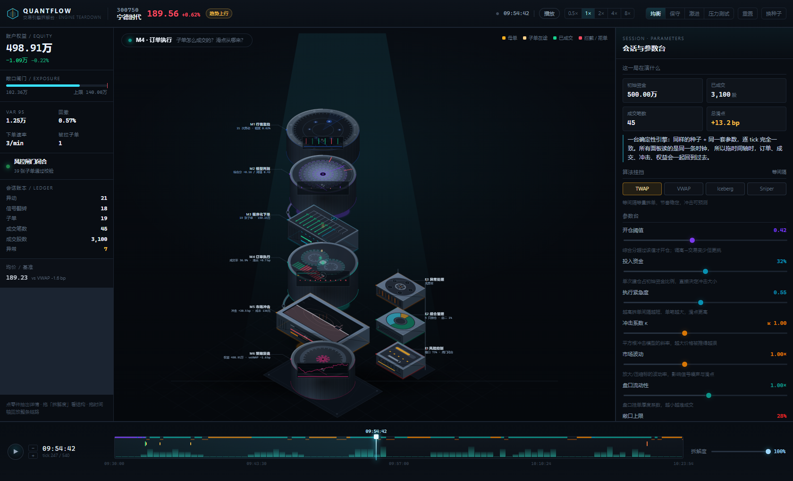
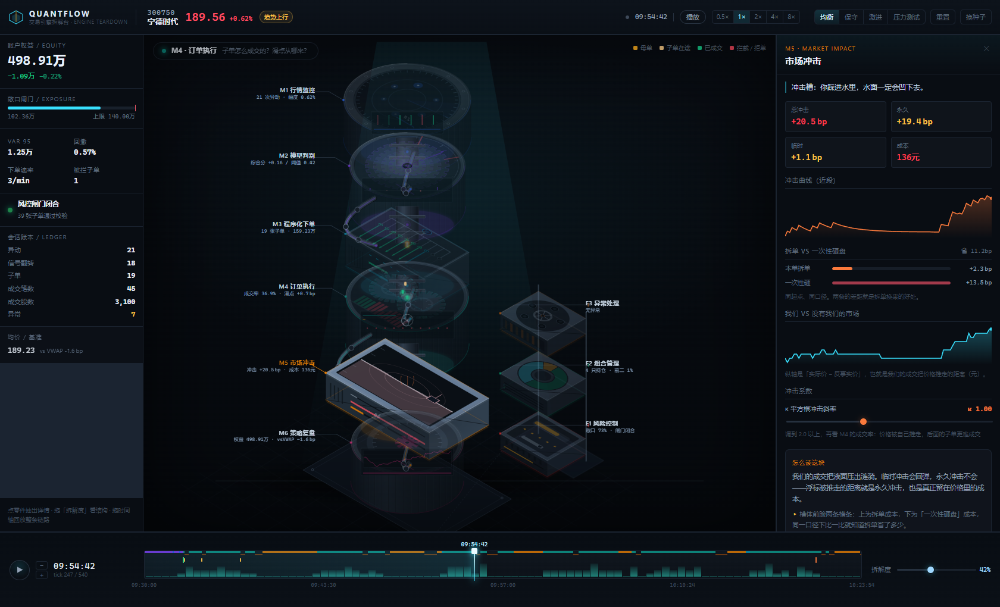
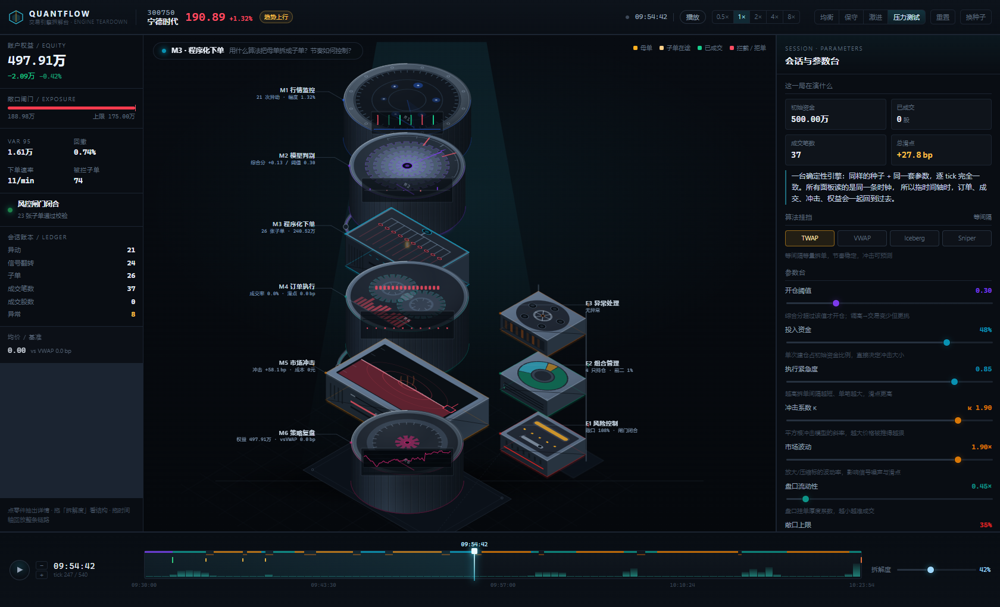
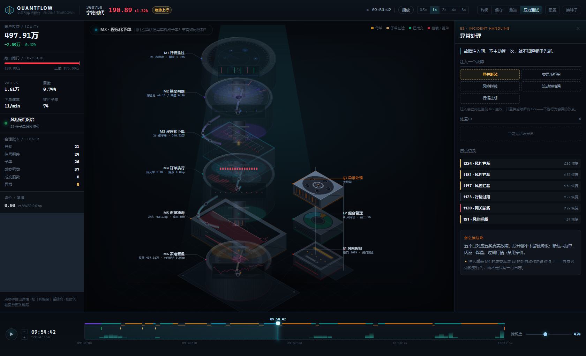

# QuantFlow · 交易引擎拆解台

把一套程序化交易系统当成**一台机器**，吊起来拆成零部件看清楚：

> 行情进来 → 模型判别 → 拆单下单 → 撮合成交 → 冲击反噬 → 复盘，
> 风控、组合、异常三只附件挂在旁边的机架上。

不是仪表盘，是**拆解台**。左侧是零件清单（等距装配体 + 引出线与实时读数），中间是机器本体，
右侧是当前零件的剖面与可调参数，底部是能把九个零件一起倒带的时间轴。


---

## 1. 为什么要做成装配体

量化交易最难讲清的不是指标，而是**因果链**：为什么这一笔滑点高、为什么那一刻熔断、
为什么这一天的收益是负的。扁平看板把这些拆成一堆互不相干的数字。

所以这里换了一套讲法：**六个主零件 + 三个附件，沿同一根主轴装在一起**。

| 零件 | 形态 | 机械隐喻 | 对应的业务机制 | 引线上的实时读数 |
| --- | --- | --- | --- | --- |
| **M1 行情监控** | 圆筒·雷达盘 | 旋转扫描盘 + 六路信号灯 | 观察池轮询、异动识别、盘口快照 | 异动次数、振幅 |
| **M2 模型判别** | 圆筒·五齿差速环 | 五只啮合齿轮 + 阈值刻度盘 + 指针 | 五因子加权、综合分与开仓阈值 | 综合分 / 阈值 |
| **M3 程序化下单** | 方箱·分液歧管 | 一个入口、N 条支管、每支一个阀门 | 母单拆成子单：TWAP / VWAP / Iceberg / POV | 子单数、委托金额 |
| **M4 订单执行** | 圆筒·双滚筒 | 两只反向滚筒咬合，落料托盘 | 撮合、排队、部分成交、成交率 | 成交率、滑点 |
| **M5 市场冲击** | 宽槽·液面 | 液面被砸出涟漪，浮标被冲走 | 临时冲击 / 永久冲击、拆单 vs 一次性砸盘成本 | 冲击 bps、成本元 |
| **M6 策略复盘** | 圆筒·记录鼓 | 走纸示波屏，权益曲线刻在纸带上 | 权益、回撤、胜率、vs VWAP | 权益、vsVWAP |
| **E1 风控闸门** | 小箱·保险管 | 保险管 + 闸刀，超限即跳闸 | 敞口上限、熔断、子单被拦 | 敞口利用率、闸门状态 |
| **E2 组合管理** | 小箱·配重盘 | 扇区配重盘 | 行业暴露、集中度 | 持仓数、前二权重 |
| **E3 异常处置** | 小箱·五孔法兰 | 手轮 + 五个可拧开的口 | 网关断线、行情跳空、拒单风暴… | 处置中的异常数 |



---

## 2. 三种看法，一条时间轴

**① 装好的机器**：`拆解度 0%`，零件贴合成整机，只能看到缝隙里透出的光。
**② 拆开看结构**：拖底部「拆解度」，零件沿主轴分离、主轴抽成联轴器、跨零件的管路露出来，
引线跟着外扩。**这一层是"它是怎么搭起来的"**。
**③ 点开看剖面**：点任意零件（或键盘 Tab + Enter），右侧抽出该零件的剖面：
关键量、分解图、以及**只影响这个环节的滑块**。

底部时间轴把九个零件绑在**同一个 tick** 上：
拖动游标，子单在途位置、成交柱、冲击羽流、权益曲线、风控灯**一起回退**。
不是重放录像——是重算到那一刻的状态（见第 4 节）。




---

## 3. 交互清单

| 操作 | 效果 |
| --- | --- |
| 拖时间轴 | 九个零件同步回退/前进到该 tick |
| 拖「拆解度」 | 装配体爆炸/合拢，引线与管路跟随 |
| 点零件 / 引出线 | 打开右栏剖面，其余零件压暗 |
| 空格 | 播放 / 暂停 |
| ← → | 单步 tick |
| Esc | 关闭剖面 |
| 预设（均衡 / 保守 / 激进 / 压力测试） | 一键换整组参数并重算 |
| 换种子 | 换一条完全不同的行情路径（同参数） |
| 强制买入 / 卖出 | 不等信号，手动插一笔母单 |
| 注入异常（E3） | 网关断线 / 行情跳空 / 拒单风暴，看下游是否真的降级 |

所有滑块改动走 **90ms 尾随防抖**再重算，拖动时不会卡住主线程。





---

## 4. 数据与确定性

没有后端、没有随机数。整场会话由 `seed + params` 一次性算出来：

```
seed + params ──► simulate() ──► SessionData
                                 ├─ snaps[540]     逐 tick 快照（价格/盘口/决策/成交/冲击/持仓/风控/复盘）
                                 ├─ fills[]        成交明细
                                 ├─ anomalies[]    异动
                                 ├─ incidents[]    异常事件
                                 ├─ equityCurve[]  权益曲线
                                 └─ summary        汇总
```

两条硬约束（有测试守着）：

1. **同 seed 同参数 → 逐 tick 完全一致**，且**禁止 `Math.random`**（`src/core/rng.ts` 是 mulberry32 派生的确定性流）。
2. **快照不得持有会被后续修改的对象引用**——盘口、子单数组在入快照前都要深拷。
   否则"回看第 120 tick"会看到第 400 tick 的盘口，时间轴倒带就成了假的。

参数表：

| 参数 | 含义 | 默认 |
| --- | --- | --- |
| `seed` | 行情路径 | `20261110` |
| `entryThreshold` | 开仓阈值 | `0.42` |
| `weights` | 五因子权重（趋势/量能/盘口/波动/情绪） | 见 `DEFAULT_PARAMS` |
| `capitalPct` | 单次投入资金占比 | `32%` |
| `algo` | 拆单算法 | `twap` |
| `urgency` | 执行紧急度 | `0.55` |
| `impactCoeff` | 冲击系数 κ | `1.0` |
| `marketVol` | 市场波动 | `1.0` |
| `liquidity` | 流动性 | `1.0` |
| `exposureLimitPct` | 敞口上限 | `28%` |
| `TOTAL_TICKS` | 会话长度 | `540` |

---

## 5. 代码结构（原子化）

```
src/
├── core/            纯函数与常量，零 React
│   ├── iso.ts       等距投影：iso(x,y,z)、三个面矩阵 topM/leftM/rightM、capRadii
│   ├── types.ts     领域模型（Snapshot / ChildOrder / Impact / Risk…）
│   ├── rng.ts       确定性随机流
│   ├── phases.ts    九阶段元数据（code/title/question/accent）
│   ├── format.ts    数字与货币格式化、clamp
│   └── labels.ts    所有中文说法集中管理
├── model/           行情/信号/拆单/撮合/冲击/风控/组合/异常/复盘 九个纯函数模块
├── engine/simulate.ts   编排：跑 540 tick，产出 SessionData
├── store/           Zustand：useSession + selectors，90ms 防抖重算
├── components/
│   ├── machine/     装配体
│   │   ├── IsoParts.tsx  原子图元：Slab / Drum / TopFace / LeftFace / WallPlate / Bolts / GaugeBar…
│   │   ├── shapes.ts     面坐标里的机械形状：齿轮/环/刻度/扇形/液面/折线
│   │   ├── CoreParts.tsx M1 M2 M3
│   │   ├── FlowParts.tsx M4 M5 M6
│   │   ├── AuxParts.tsx  E1 E2 E3
│   │   ├── PacketLayer.tsx 母单/子单/成交火花/冲击羽流
│   │   └── MachineStage.tsx 装配几何、引线、管路、台面
│   ├── panels/      TopBar / LeftRail / DetailRail / Timeline
│   └── ui/          Spark / Bars / Metric / RowBar / Gantt / StackBar / Section
└── styles/          tokens / base / app / rail
```

分层规则：`core` 不认识 React，`model` 不认识 DOM，组件拿到的是**快照**而不是可变状态。

---

## 6. 开发

```bash
npm ci          # 或 npm install
npm run dev     # http://127.0.0.1:5178
npm test        # 25 条用例
npm run build   # tsc --noEmit && vite build
npm run preview # http://127.0.0.1:4178
```

> 端口写死并加了 `--strictPort`：本机曾有旧实例占着 5178，端口被顶掉会静默拍到旧页面。

### 测试

- `src/__tests__/engine.test.ts`（14 条）：确定性、换种子、快照隔离、母单先于成交、
  拆单成本低于一次性砸盘、敞口上限真的拦下子单、注入异常留痕、手动下单……
- `src/__tests__/app.test.tsx`（11 条）：九零件标签齐全、点击开合剖面、键盘步进不越界、
  预设改参、滑块写参、换算法触发重算、拆解度可改。

### 视觉回归

```bash
python scripts/snap.py shots/now.png http://127.0.0.1:5178/ --stop 0.45 --explode 0.6
python scripts/shot.py shots/preview http://127.0.0.1:5178/   # 七个状态 + 控制台错误数
```

`shot.py` 会打印 `CONSOLE_ERRORS`，交付标准是 `0`。

---

## 7. 已知边界

- 这是**教学/演示沙盘**，行情与撮合是仿真，不接真实柜台，不能用来验证策略收益。
- 五个因子的权重可调，但因子本身是脚本化生成的，不是真实因子库。
- 窄屏（< 1200px）会把右栏折到时间轴下方，装配体高度受限，细节会变小——大屏是主场景。
- 等距投影是正交投影，没有真实光照与景深；"金属感"靠渐变与棱线手绘出来。
